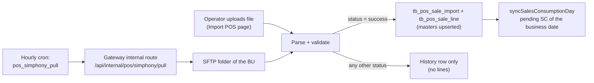

# Import POS (Simphony / Micros 3700)

> **At a Glance**
> **Purpose:** Bring daily POS sales into the system as raw sale lines, which [Sales Consumption](/en/inventory/recipe/sales-consumption) then turns into stock deductions &nbsp;·&nbsp; **Screen:** `/operation-plan/import-pos` (menu: Operation Plan → Import POS) &nbsp;·&nbsp; **Settings:** `/system-admin/interface/pos/simphony` and `/system-admin/interface/pos/micros3700` &nbsp;·&nbsp; **API:** `api/:bu_code/pos-sales/imports*` &nbsp;·&nbsp; **Tables:** `tb_pos_store`, `tb_pos_outlet`, `tb_pos_department`, `tb_pos_item`, `tb_pos_sale_import`, `tb_pos_sale_line`, `tb_pos_sftp_pull_run` &nbsp;·&nbsp; **Audience:** Developers and QA; sysadmin for the connection settings

> **Scope note.** This page documents the inventory-relevant behaviour: what an import writes, when it is rejected, and how it feeds stock deduction. Pure connectivity configuration (SFTP host fields, licences) is only summarised in §6.
>
> **Implementation status (verified 2026-10-27).** Implemented: Simphony Standard Export upload, Micros 3700 report check + import with per-outlet overwrite, scheduled Simphony SFTP pull, import history, cancel. There is no automatic Stock Out at import time — the earlier per-outlet "preview / confirm" flow was removed (`ea3fc5c95`); deduction happens only when a Sales Consumption is posted.

## 1. Overview

Every attempt is recorded, including failures, so the history shows what was tried. Only an empty or binary file is answered with HTTP 400 and not recorded.

## 2. Brands and File Formats

| Brand | Input | Granularity of one import | Duplicate key (live success rows) |
|---|---|---|---|
| `simphony` | Simphony Standard Export text file: one `GLID` header + `MID` lines, single business date, ≤ 10 MB | One import per store per business date | Partial unique index `pos_sale_import_live_success_u` on `(store_id, doc_date)` where `status = 'success'`, not cancelled, brand `simphony` |
| `micros3700` | Micros 3700 report: the browser extracts the PDF text lines (`micros3700-pdf.ts`) and sends lines, not the file; check then import | One import per **outlet** per business date; rows from one PDF share a `batch_id` (rejected rows included) | `pos_sale_import_live_outlet_u` on `(outlet_id, doc_date)` for brand `micros3700` |

The duplicate key is store + business date, **not** the `source` string, because `source` embeds the POS version (`GLID#11`); a re-export after a POS upgrade would otherwise slip through (comment in `schema.prisma`).

### 2.1 Simphony parsing rules (`simphony.parser.ts`)

- `GLID` header required; store number (#2) must not be empty; business dates must be `YYYYMMDD` and a real date; first and last date must be the same day.
- Each `MID` line needs at least 40 fields; outlet code (#2) and item code (#4) must not be empty; outlet, item and department codes ≤ 20 characters (columns are `VarChar(20)`).
- A file whose version is below 1.17 imports successfully with warning `legacy_export_version`.
- A file with no `MID` line is a `format_error`.

### 2.2 Import statuses (`enum_pos_sale_import_status`)

| Status | Meaning |
|---|---|
| `success` | Lines written; masters (store, outlet, department, item) upserted |
| `rejected_duplicate` | A live successful import already exists for the same store (Simphony) / outlet (Micros) and business date. Shown yellow — not an error |
| `missing_glid_header` | Simphony: no `GLID` header |
| `multi_day_glid_reject` | Simphony: the `GLID` header spans several business dates |
| `rejected_multi_day` | Micros 3700: the report period spans several business dates |
| `format_error` | Any other parse/format problem (message in `error_message`) |

`ingest_method` is `manual` or `sftp`. History shows `line_count` and `confirmed_line_count` (lines already deducted); the UI derives a confirmation state: replaced, cancelled, not applicable, pending (0 deducted), partial, confirmed (`pos-import-status.ts`).

## 3. Manual Upload

| Step | Endpoint | Behaviour |
|---|---|---|
| Simphony upload | `POST pos-sales/imports/simphony` (multipart `file`) | Needs licence `interface.pos.simphony`; returns 201 with the summary even for rejections |
| Micros check | `POST pos-sales/imports/micros3700/check` (body: file name, extraction time, text lines) | Needs `interface.pos.micros3700`. Returns `ready` (per outlet: what would be imported and what it would replace) or `rejected`. Not write-free: it upserts the store row and records a rejected file in history; it never writes outlets, items or lines |
| Micros import | `POST pos-sales/imports/micros3700` | Re-checks from scratch and imports outlet by outlet. An outlet that already has a live import must be named in `overwrite` (with the `import_id` and `stock_out_ids` the check showed) or in `skip_outlet_codes`; otherwise the response is `needs_resolution` and nothing is written. One failing outlet never loses the others' results; a request time budget is enforced (`POS_SALE_IMPORT_TIME_BUDGET`) |
| Overwrite | inside the import | The old import is cancelled and marked `replaced_by_id`; if its lines are already on a **posted** Sales Consumption the outlet fails with `POS_SALE_OUTLET_IN_POSTED_SC` — void the SC first. Consent that no longer matches what the user saw fails with `POS_SALE_OVERWRITE_CONFLICT` |
| Cancel | `POST pos-sales/imports/:import_id/cancel` | Only a `success`, not-yet-cancelled import with no deducted line and not on a posted SC; else `POS_SALE_IMPORT_NOT_CONFIRMABLE`, `POS_SALE_IMPORT_CANCELLED` or `POS_SALE_IMPORT_HAS_CONFIRMED_LINES`. Re-syncs the day's SC |
| History / detail | `GET pos-sales/imports`, `imports/:import_id`; `GET stores`, `outlets`, `items` | Filters include `brand`, `batch_id`; items filter `unmapped` / `mapped` / `ignored` |

On the page, upload buttons appear only for enabled brands whose licence is not expired, when the BU contract is writable (`canWrite`). The history table links to the selected import's lines and, per line, to its Stock Out (`/inventory-management/inventory-adjustment/:id?type=stock-out`).

## 4. Scheduled Simphony SFTP Pull

- Trigger: `micro-cronjobs` job type `pos_simphony_pull` (`bu_codes`, `user_id`), recommended hourly (`0 * * * *`, `max_retries: 0`); it calls the gateway's internal route `POST /api/internal/pos/simphony/pull` with `x-internal-token` (`InternalJobGuard`, not Keycloak). The `user_id` becomes the actor of the created imports and the recipient of the failure notification, so it must belong to every listed BU.
- The backend decides whether the pull is due: it compares the **hour** of the BU-local time with the hour of `schedule_time` (minutes ignored) and skips when a `completed` run for that business day already exists (`isPullDue`). Timezone is the BU's; an unknown timezone falls back to a default.
- Fixed limits (`SFTP_PULL_SETTINGS`): connect timeout 30 s, 3 retries 60 s apart (max 4 attempts), look back 7 days, files must be older than 5 minutes, max 50 files and 10 MB per file per run, run budget 25 min, a `running` run older than 30 min is abandoned. Only one `running` row per brand (partial unique index `pos_sftp_pull_run_running_u`).
- Files in the remote folder are filtered by the configured glob (`*`, `?`, case-insensitive, no `/`), then imported like a manual upload (`ingest_method = sftp`). Run results: `tb_pos_sftp_pull_run.status` ∈ `running` / `completed` / `connect_failed` / `host_key_mismatch` / `failed` / `abandoned`, with per-file outcomes `imported` / `rejected` / `failed` / `too_large` / `not_attempted`. The host key is pinned only from a run that passed authentication; a mismatch is stored for the admin to compare but never used as a pin.
- Failure alerts are sent once per day (`is_alert_sent`). `GET pos-sales/sftp-pulls/latest` feeds the "last pull" panel on the Import POS page.

## 5. What an Import Writes

1. Upserts the store (`brand` + `store_key`), outlets, departments and items found in the file (`pos-sale-master-upsert.ts`). New outlets start with **no Location**; new items start with **no recipe** and `is_ignored = false` — they must be mapped in Sales Consumption before posting.
2. Writes `tb_pos_sale_import` (`doc_date`, `total_records`, `total_sales_amount`, `warnings`) and one `tb_pos_sale_line` per (import, outlet, item) — unique `pos_sale_line_import_outlet_item_u`.
3. Calls `syncSalesConsumptionDay` for the business date in the same transaction (see [Sales Consumption §8](/en/inventory/recipe/sales-consumption)).

No stock moves at this point.

## 6. POS Interface Settings (summary)

Per-BU config stored as `tb_application_config` rows `interface_pos_simphony` and `interface_pos_micros3700` (page `/system-admin/interface`; the old combined POS form was split, `f447132b`).

| Brand | Fields | Notes |
|---|---|---|
| Simphony | `enabled`, `sftp_host` (hostname/IPv4/IPv6), `sftp_port` (1–65535, default 22), `sftp_username`, `sftp_password`, `remote_folder_path` (default `/export/`, no `..`), `file_pattern` (default `GLExport_*.txt`, ≤ 100 chars, no `/`), `schedule_time` (`HH:mm`, default `03:00`) | Password is stored encrypted and returned masked as `***ENCRYPTED***`; resaving the mask keeps the stored secret. The pull rejects loopback / link-local hosts (`resolve-allowed-host.ts`) |
| Micros 3700 | `enabled` only | Upload-only brand; no connection |

`enabled === true` on at least one brand is what makes Import POS and Sales Consumption appear (`readEnabledPosBrands`, `GET pos-sales/status`). Enabling needs the brand licence; an expired licence leaves the screens readable but read-only.

## 7. Edge Cases

| # | Case | Behaviour |
|---|---|---|
| 1 | Same Simphony store/date uploaded twice | Second is recorded as `rejected_duplicate`; also guarded against parallel uploads by the partial unique index (loser re-read and recorded as duplicate) |
| 2 | Cancelled import re-uploaded | Allowed — the unique index only covers live (not cancelled) successes |
| 3 | File for a date in a closed period | Imports fine; the period gate applies later when the SC is posted |
| 4 | Item code longer than 20 chars | Whole file rejected as `format_error` |
| 5 | Late file after the day's SC is posted | Lines stay unattached ("late lines") until the SC is voided |
| 6 | BU with SFTP disabled / unset | Pull is skipped without error; invalid stored timezone does not raise |
| 7 | Two cron instances / manual trigger overlap | Single `running` row per brand (partial unique index); a second run cannot start while one is running |

## 8. Sources

`apps/micro-business/src/inventory/pos-sale/{pos-sale-import.service.ts,pos-sale-micros3700.service.ts,pos-sale-sftp-pull.service.ts,parsers/*,sftp/*,import-writer/*}`, gateway `application/pos-sales/{pos-sales.controller.ts,pos-sales-internal.controller.ts}`, schema `tb_pos_*`, `micro-cronjobs` `internal/executor/pos_simphony_pull.go` and README, frontend `routes/operation-plan/import-pos/*` and `routes/system-admin/interface/pos/*`. Related: [Sales Consumption](/en/inventory/recipe/sales-consumption), [Application Config](/en/inventory/system-config/application-config).
