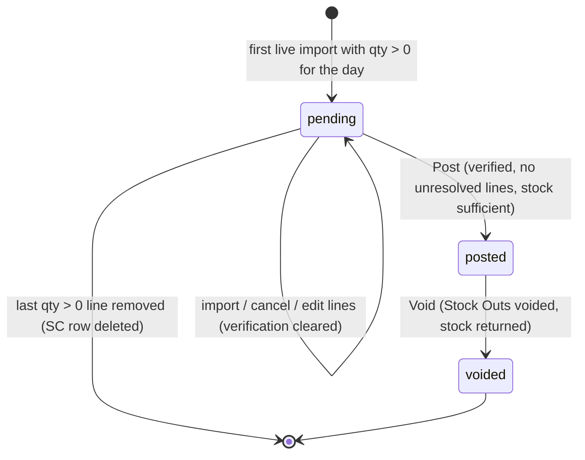

# Sales Consumption (POS Sales → Stock Out)

> **At a Glance**
> **Purpose:** Turn imported POS sales into stock deductions — one document per sale day, recipes exploded to ingredients, posted as one completed `SALE` Stock Out per location &nbsp;·&nbsp; **Screens:** `/operation-plan/sales-consumption` (calendar / table / mapping) and `/operation-plan/sales-consumption/:id` &nbsp;·&nbsp; **Tables:** `tb_sales_consumption`, `tb_pos_sale_line`, `tb_pos_item`, `tb_pos_outlet`, `tb_stock_out.sales_consumption_id` &nbsp;·&nbsp; **API:** `api/:bu_code/pos-sales/sales-consumptions*` &nbsp;·&nbsp; **Status values:** `pending` / `posted` / `voided` &nbsp;·&nbsp; **Audience:** Developers and QA (stock deduction path); Cost Controller and Outlet Manager as users

> **Implementation status (verified against source 2026-10-27).** Fully implemented end to end: the feature landed in the backend as PR #945 (`feature/sales-consumption`, merged) and in the frontend between `f75b4b2a` and `27eaf276`. This is the first place recipes actually drive inventory movements. It is **not** a food-cost variance report: nothing compares these deductions with physical counts, and the earlier "theoretical consumption" design (see [Recipe](/en/inventory/recipe) §3) is realised here only as a human-verified daily posting, not a per-sale automatic OUT.

## 1. Overview

Point-of-sale systems report what was *sold* (menu items); inventory needs to know what was *consumed* (products). Sales Consumption (SC) bridges the two:

```
POS file (Simphony / Micros 3700)  →  Import (raw sale lines, per store/outlet/item)
   →  Sales Consumption of that sale day (pending)
   →  map each line to a Location + a Recipe (or Ignore)
   →  explode recipes (sub-recipes, wastage, unit conversion) into product quantities
   →  Verify on-hand per location (as of the sale date)
   →  Post  →  one completed Stock Out (adjustment type SALE) per location, dated the sale day
```

Rules of thumb:

- **One live SC per sale day.** A partial unique index `sales_consumption_live_day_u` on `(sale_date)` where `status <> 'voided'` allows only one non-voided SC per day (migration SQL, not expressible in Prisma). Voided SCs stay as history.
- **SC number** is `SC-YYYYMMDD-NN`, where `NN` = (number of that day's SCs of every status) + 1 (`nextScNo`). A void therefore produces `-02` for the replacement.
- **Import side** is covered in [Import POS](/en/inventory/recipe/import-pos). This page starts when live sale lines exist.
- The module is visible only when the BU has a POS interface switched on (§9).

## 2. Entities and Statuses

| Entity | Role | Key fields (source: `schema.prisma`) |
|---|---|---|
| `tb_pos_sale_import` | One uploaded/pulled POS file | `brand` (`simphony`/`micros3700`), `doc_date` (business date), `status`, `cancelled_at` |
| `tb_pos_sale_line` | One item sold at one outlet in one import | `import_id`, `outlet_id`, `item_id`, `qty`, `unit_price`, `total`; overrides `location_id`, `recipe_id`, `is_ignored` (nullable = "follow master"); `sales_consumption_id`, `stock_out_id` |
| `tb_pos_outlet` | POS outlet master | `store_id`, `code` (≤ 20), `name`, `location_id` (outlet → Location mapping) |
| `tb_pos_item` | POS menu item master | `store_id`, `code` (≤ 20), `desc1`, `recipe_id` (item → Recipe mapping), `is_ignored` (default false) |
| `tb_sales_consumption` | The daily document | `sc_no`, `sale_date`, `status`, `onhand_verified_at`, `onhand_verified_ok`, `onhand_verified_signature`, `posted_*`, `voided_*`, `void_reason`, `doc_version` |
| `tb_stock_out` | Result of posting | `sales_consumption_id` FK (Restrict); one row per location; `info = { sales_consumption_id }` |

`enum_sales_consumption_status`: `pending` → `posted` → `voided`. There is no draft/approval stage.



A void re-opens the day as a **new** pending SC (when lines are left to deduct); the voided document itself is never reused.

## 3. How a Sale Line Is Resolved

Each sale line is resolved to an effective **location**, **recipe** and **ignore** flag by `resolveLine` (`sales-consumption/resolve-line.ts`). A value on the *line* wins over the *master*.

| Aspect | Rule |
|---|---|
| Location | `line.location_id` if set, else `outlet.location_id`. A soft-deleted location counts as **no location**. |
| Recipe / ignore | `line.is_ignored = true` → ignored, no recipe. Else `line.recipe_id` → that recipe. Else `line.is_ignored = false` with no recipe → explicitly "no recipe". Otherwise the master `tb_pos_item` (`recipe_id`, `is_ignored`). A DB CHECK forbids `is_ignored = true` together with a `recipe_id`. |
| State (first match wins) | `qty ≤ 0` or ignored → `not_counted` · no location → `needs_location` · no recipe → `needs_recipe` · else `ok` |

`needs_location` and `needs_recipe` are the **unresolved** states. They block both Verify and Post. Lines already deducted (`stock_out_id` set) are not re-exploded.

### 3.1 Editing lines (`PATCH .../sales-consumptions/:id/lines`)

Body: `line_ids[]`, and any of `location_id`, `recipe_id`, `is_ignored`, plus `set_item_default`. Rules in `updateLines`:

- SC must be `pending`; every id must belong to this SC and be undeducted, else `SALES_CONSUMPTION_LINE_POSTED`.
- At least one of the three fields must be present; `recipe_id` together with `is_ignored = true` is rejected (`COMMON_VALIDATION_FAILED`). A `location_id` / `recipe_id` that does not exist (soft-deleted counts as missing) is rejected.
- With `set_item_default = true` the recipe/ignore value is written to the **item master** and the line goes back to "follow master" (`recipe_id = null`, `is_ignored = null`); otherwise it is a per-line override. A location is always a per-line override.
- Any edit clears the stored on-hand verification and bumps the SC `doc_version`.

## 4. Recipe Explosion

`explodeSaleLines` (`pos-sale/explosion/explode-sale-lines.ts`) converts `ok` lines into **product → inventory-unit quantity**. It deliberately mirrors the recipe cost calculator so deducted quantity agrees with recipe cost.

1. For a sold recipe: `batches = sold_qty ÷ recipe.base_yield`.
2. Product line: inventory qty = the saved `inventory_qty` when it was saved against the product's current inventory unit, otherwise `qty × from_qty ÷ to_qty` (unrounded ratio). Multiply by `(1 + wastage% / 100)`.
3. Sub-recipe line: its `qty` must be in the sub-recipe's `base_yield_unit` (1:1); sub-recipe batches per parent batch = `qty × (1 + wastage%/100) ÷ sub.base_yield`, applied to the sub-recipe's own per-batch needs, recursively (max **10** levels, `MAX_RECIPE_DEPTH`; the sold recipe is level 1).
4. Totals are rounded half-up to 5 dp at the end.

A sold line that cannot be exploded is **not half-deducted**: it adds nothing and is reported as a problem with one of these reasons:

| Reason | Meaning |
|---|---|
| `no_conversion` | Product missing/soft-deleted, unit cannot convert (either side of the ratio ≤ 0), or a sub-recipe line in a unit other than the sub-recipe yield unit |
| `zero_yield` | A recipe in the chain has `base_yield ≤ 0` |
| `too_deep` | Nesting beyond 10 levels (a sub-recipe loop ends up here too) |
| `recipe_unusable` | Recipe missing, `is_active = false`, or soft-deleted |
| `empty_recipe` | The walk yields no positive quantity (no live ingredient lines, or only zero-qty lines) |

These "ingredient problems" show on the detail page and count as unresolved: they block Verify and Post exactly like `needs_*` lines.

> The recipe's `deduct_from_stock` flag ([Data Model](/en/inventory/recipe/01-data-model)) is **not read** by the explosion. A recipe with `deduct_from_stock = false` is still deducted when a POS line maps to it. See §10.

## 5. Verify On-Hand (`POST .../sales-consumptions/:id/verify-onhand`)

- Requires `pending` and zero unresolved lines/problems.
- For each location and ingredient, compares required quantity with `getDrawableQtyAsOf(product, location, sale_date, costing method)`. `short = required − available` when it exceeds `1e-9`.
- Stores `onhand_verified_at`, `onhand_verified_ok` (true only when nothing is short) and `onhand_verified_signature` — a SHA-256 over the sorted effective lines (id, location, recipe, ignore flag, qty). Any later change to a line, a master mapping that alters resolution, or a new/cancelled import changes the signature (or clears the fields) and makes the verification **stale**.
- The per-product result of the last verify is only held in the browser page; after a refresh the detail endpoint returns just time / ok / stale, and the **Post** button decides from that stored verification.

## 6. Post (`POST .../sales-consumptions/:id/post`, body `doc_version`)

One database transaction (timeout 25 s). Any failure posts nothing. Order of checks in `post()`:

1. SC lock: day-level advisory lock, then the SC row; status must be `pending` (`SALES_CONSUMPTION_NOT_PENDING`); `doc_version` must match (optimistic lock). A missing `doc_version` is `COMMON_DOC_VERSION_REQUIRED`.
2. **Period gate:** the sale date must fall in the current open inventory period (`STOCK_OUT_DATE_NOT_CURRENT_PERIOD` / `STOCK_OUT_NO_OPEN_PERIOD`).
3. Unresolved lines or ingredient problems → `SALES_CONSUMPTION_HAS_UNRESOLVED_LINES` (with `count`).
4. Verification must exist, match the current signature, and be `ok`: `SALES_CONSUMPTION_NOT_VERIFIED` / `_VERIFY_STALE` / `_VERIFY_FAILED`.
5. Adjustment type with code **`SALE`** (type stock-out, not deleted, active) must exist, else `POS_SALE_ADJUSTMENT_TYPE_MISSING`. It is created by the tenant seed set `pos-sale-adjustment-type.seed-set.ts` (`cc2ab4eba`).
6. Stock is **re-checked inside the transaction** (it may have moved since Verify); shortages of every location are reported together as an insufficient-stock error.
7. Stock Out numbers are reserved (`STOCK-OUT` series, dated the sale day), then per location (sorted by location code) a **completed** Stock Out is written: draft header → one detail row and one ledger movement per ingredient (`executeAdjustmentOut`, valued by the BU costing method) → `completed`. Description: `Sales Consumption <sc_no> · <loc code> <loc name>`. One detail line per ingredient product with positive total, with product code/name/local name/sku snapshots.
8. Sale lines are claimed (`stock_out_id` set) with a conditional update; if any line was taken concurrently the whole post rolls back (`POS_SALE_CONFIRM_CONFLICT`).
9. SC becomes `posted` with `posted_at`, `posted_by_id`, `doc_version + 1`.

Lines in `not_counted` state (qty ≤ 0 or ignored) get no Stock Out but stay attached to the posted SC.

## 7. Void (`POST .../sales-consumptions/:id/void`, body `void_reason?`, `doc_version`)

Permission `inventory_management.stock_out.delete` (not tied to POS being enabled in the UI — a BU that switched POS off can still void).

1. SC must be `posted`; `doc_version` must match.
2. The sale day's period must still be open, else `SALES_CONSUMPTION_VOID_PERIOD_CLOSED`.
3. Every non-voided Stock Out of the SC is voided in the same transaction (`voidStockOutInTx` with `viaSalesConsumption: true`) — stock is returned. Voiding such a Stock Out *directly* from the Inventory Adjustment screen is refused with `STOCK_OUT_VOID_VIA_SALES_CONSUMPTION` ("void it from the Sales Consumption instead").
4. SC → `voided` (`voided_at`, `voided_by_id`, `void_reason`); its lines are released and `syncSalesConsumptionDay` creates a **new pending SC** for that day taking those lines plus any late lines (§8). `new_sc_id` is `null` when nothing is left to deduct. The UI navigates to the new SC.

## 8. Daily Sync and Late Lines

`syncSalesConsumptionDay` (called inside every import, cancel and overwrite transaction, under the day advisory lock):

- Eligible lines: `stock_out_id IS NULL`, import `status = success`, not cancelled, `doc_date = sale day`.
- No live SC and at least one eligible line with `qty > 0` → create a pending SC. Otherwise attach every eligible line (any qty) and detach lines whose import was cancelled.
- If no line with `qty > 0` remains, lines are released and the pending SC row is **deleted**.
- If the line set changed, on-hand verification fields are cleared.
- If the day's SC is already `posted`, the function returns without attaching: lines from imports arriving later are **late lines** (`late_lines` on the detail and calendar). They sit unattached until the posted SC is voided (§7) — there is no "add to posted SC" action.

An import cannot be cancelled once any of its lines is deducted or belongs to a posted SC (`POS_SALE_IMPORT_HAS_CONFIRMED_LINES`; `LOCKED_SALE_LINE` in `pos-sale.constants.ts`).

## 9. Screens, Permissions and Visibility

| Screen / action | Source | Gate |
|---|---|---|
| Menu entries **Import POS** and **Sales Consumption** under Operation Plan | `constant/module-list.ts` | Hidden unless the BU has ≥ 1 POS brand enabled (`requiresPosInterface`, `useVisibleModules`; direct URL shows a "POS not enabled" page via `RouteGuard`). Licence feature `interface.pos`. Sales Consumption additionally needs `inventory_management.stock_out.view`; Import POS lists no permission in the menu. |
| `/operation-plan/sales-consumption` | `sc-list-page.tsx` | Tabs: **calendar** (default), **list**, **mapping** (`?view=`), month in `?month=`. Summary strip above; a warning bar when any POS outlet has no Location (button opens mapping, shown only to writers). |
| `/operation-plan/sales-consumption/:id` | `sc-detail-page.tsx` | Tabs **Sales** (default; **Ingredients** for a voided SC), **Ingredients**, **History**. Header shows SC no., status, sale date, number of imports, sales amount, linked Stock Outs (voided ones struck through, unlinkable), and for a voided SC the replacement SC. |
| List / detail / calendar APIs | gateway `pos-sales.controller.ts` | `inventory_management.stock_out.view` |
| Edit lines, Verify, Post, PATCH outlets/items (mapping) | same | `inventory_management.stock_out.create` |
| Void | same | `inventory_management.stock_out.delete` |
| Import / cancel / history / stores / outlets / items GET | same | No `@Permission`; license `interface.pos` (`'app:pos-sales': 'interface.pos'` in `permission.route-map.ts`) and, for uploads, the per-brand licence `interface.pos.simphony` / `.micros3700` |

In the UI, edit controls need `usePosWritable()`: BU contract writable **and** `stock_out.create` **and** at least one enabled brand whose licence is not `expired`. Expired licence = read-only.

Every SC service method first checks that a POS brand is enabled in the BU's interface settings (`readEnabledPosBrands`: `interface_pos_simphony` / `interface_pos_micros3700` with `value.enabled === true`); otherwise `SALES_CONSUMPTION_POS_NOT_ENABLED`. `GET .../pos-sales/status` returns the enabled brands.

### 9.1 Calendar day states (`buildCalendar`)

| `status` | Condition (first match) |
|---|---|
| `posted` | Day has a posted SC |
| `pending` | Day has a pending SC, or live lines with qty > 0 exist |
| `no_sales` | Live import exists for the day but no line has qty > 0 |
| `future` | Day ≥ today |
| `before_start` | Before the first live import ever |
| `no_file` | Past day on/after the first import with no live import |

Extra counters per day: `unresolved_count`, `late_lines` (posted days only), and `missing_stores` — stores that had a live import in the previous 7 days but none on this day (only for days between the first import day and today).

### 9.2 Mapping tab

Two grids over the masters: **Outlets** (outlet → Location; `PATCH pos-sales/outlets/:outlet_id`, Location must exist) and **Items** (item → Recipe or Ignore; `PATCH pos-sales/items/:item_id`, recipe must exist and not be combined with `is_ignored = true`; filter `unmapped` / `mapped` / `ignored`). Changing a master mapping re-resolves every *pending* line that follows master and thereby makes an earlier verification stale. Posted lines are not touched.

## 10. Edge Cases

| # | Case | Behaviour |
|---|---|---|
| 1 | Two people post the same SC | Row lock + `doc_version`: the second gets a stale-version / not-pending error; one set of Stock Outs only |
| 2 | Stock changes between Verify and Post | Post re-checks inside its transaction; shortfall aborts everything and lists all short ingredients |
| 3 | Edit a line after Verify | Verification cleared; Post fails with `SALES_CONSUMPTION_NOT_VERIFIED` until re-verified |
| 4 | Location deleted after mapping | Lines become `needs_location` |
| 5 | Recipe deactivated / deleted after mapping | Explosion problem `recipe_unusable` blocks the day. (Deactivating/archiving a recipe that other recipes use is blocked at the recipe level, but POS item mappings are not checked.) |
| 6 | Same recipe sold at several outlets/locations | Exploded per effective location; one Stock Out per location |
| 7 | Sale date in a closed period | Post refused (`STOCK_OUT_DATE_NOT_CURRENT_PERIOD`); void refused (`SALES_CONSUMPTION_VOID_PERIOD_CLOSED`) |
| 8 | File imported after the day is posted | Becomes a late line; flagged on the calendar; picked up only after a void |
| 9 | Cancel an import whose lines are on a pending SC | Allowed; lines detach, SC re-synced or deleted |
| 10 | Micros 3700 overwrite of an outlet whose lines are on a posted SC | Outlet fails with `POS_SALE_OUTLET_IN_POSTED_SC`; void the SC first |
| 11 | POS integration switched off while documents exist | List/detail/post/verify return `SALES_CONSUMPTION_POS_NOT_ENABLED`; void still works |
| 12 | Zero-quantity or voided POS lines | `not_counted`; never deducted |

## 11. Code Findings and Recommendations

| Finding | Evidence | Suggestion |
|---|---|---|
| `deduct_from_stock` is dead for POS deduction | `explode-sale-lines.ts` / `load-recipe-graph.ts` never select the column | Either honour the flag when resolving a line, or remove the toggle from the recipe form |
| Recipe-level guards ignore POS mappings | `findRecipeUsers` only scans `tb_recipe_ingredient` | Include `tb_pos_item.recipe_id` in the "in use" check, or surface it in the error |
| Detail-page per-product verify result is lost on refresh | `sc-detail-page.tsx` keeps it in component state | Persist the per-product result or re-fetch on demand |
| Test coverage | `carmen-frontend-e2e` at `d795a25` has no spec, test-case catalogue or user story for Import POS / Sales Consumption (tree listing checked for `pos`/`sales`/`consum`) | See [Test Scenarios](/en/inventory/recipe/04-test-scenarios) for the manual matrix to automate |

## 12. Sources

- Backend: `apps/micro-business/src/inventory/sales-consumption/*` (service, sync, calendar, ingredients, history, `resolve-line.ts`, `line-signature.ts`, `pos-enabled.ts`), `apps/micro-business/src/inventory/pos-sale/{stock-out-poster.ts,explosion/*,pos-sale-mapping.service.ts}`, gateway `apps/backend-gateway/src/application/pos-sales/pos-sales.controller.ts`, error catalog `SALES_CONSUMPTION_*` / `POS_SALE_*`.
- Schema: `packages/prisma-shared-schema-tenant/prisma/schema.prisma` (`tb_sales_consumption`, `tb_pos_*`, `tb_stock_out.sales_consumption_id`).
- Frontend: `carmen-frontend/routes/operation-plan/{sales-consumption,shared}/*`, `constant/module-list.ts`, `hooks/use-visible-modules.ts`, `components/route-guard.tsx`.
- Related: [Import POS](/en/inventory/recipe/import-pos), [Recipe](/en/inventory/recipe), [Data Model](/en/inventory/recipe/01-data-model), [Business Rules](/en/inventory/recipe/02-business-rules).
