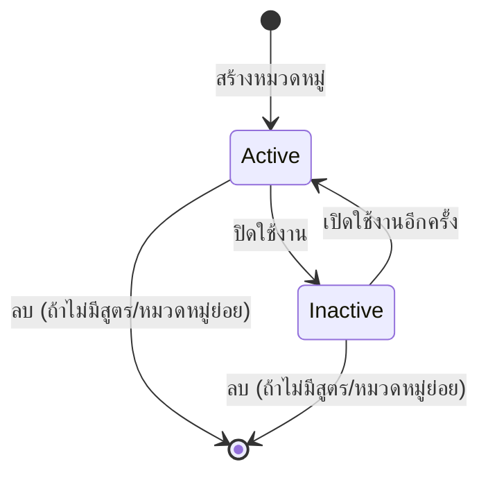

# หมวดหมู่สูตรอาหาร (Recipe Category)

> **At a Glance**
> **เจ้าของ:** Chef / Product Admin &nbsp;·&nbsp; **ตาราง:** `tb_recipe_category` &nbsp;·&nbsp; **รูปทรง:** ต้นไม้เชิงลำดับชั้น (self-FK บน `parent_id`) &nbsp;·&nbsp; **ใช้โดย:** ส่วนหัวของ [recipe](/th/inventory/recipe), menu engineering, รายงาน cost-band &nbsp;·&nbsp; **Seed:** food-cost % เป้าหมายของ form สูตร (จาก `default_cost_settings`); ค่า default อื่นแสดงเพื่อเปรียบเทียบเท่านั้น

> **ตรวจสอบซ้ำ 2026-09-22** schema และกฎของ service ด้านล่างไม่เปลี่ยน การเปลี่ยนแปลงของสัญญา API: response ของ list/detail serialize ผ่าน `RecipeCategoryResponseSchema` (`config_recipe-categories/swagger/*`, 2026-09-17) — parent กลับมาเป็น `parent: { id, name } | null` และ**ไม่มี `parent_id` บนสาย**ตอนอ่าน (`types/recipe-category.ts`; grid/ฟอร์มอ่านจาก object ตั้งแต่ `768af593`); create/update/patch ยังส่ง `parent_id` การอ่านถูกเสริมด้วย object `audit` แทน `created_*`/`updated_*` ดิบ; มี `image_url` รวมอยู่ `GET /api/config/{bu}/recipe-categories` default เป็น `sort=code:asc` (`b375b078b`) E2E: `tests/110-op-category.spec.ts` (13 test, 2026-09-20)

> **ตรวจสอบซ้ำ 2026-10-27** ไม่มีการเปลี่ยนแปลง backend ของ category Frontend (`d443837c`, `4e950086`, `8e0d16d8`): list เพิ่มคอลัมน์ **Food cost** และ **Margin** และรวม parent เข้าไปในคอลัมน์ชื่อ; หน้า edit แทนที่บล็อก cost / margin แยกกันด้วย section **Pricing** เดียว — food cost %, labor %, overhead %, margin กำไรขั้นต่ำและเป้าหมาย — บวกแท่งกราฟซ้อนที่แบ่ง 100 % ของราคาขายเป็น food cost │ labor │ overhead │ กำไรที่เหลือ พร้อมเครื่องหมาย margin ขั้นต่ำ / เป้าหมาย (`recipe-category-price-breakdown.tsx`; เตือนเมื่อสามต้นทุนเกินเครื่องหมาย margin เท่านั้น ไม่เคย block การ save) Key ที่เก็บ: `default_cost_settings.{target_food_cost_percentage, labor_cost_percentage, overhead_percentage}` และ `default_margins.{minimum_profit_margin, target_profit_margin}` **สิ่งที่สูตรสืบทอด:** เฉพาะ `target_food_cost_percentage` ที่คัดลอกเข้า form สูตรเมื่อผู้ใช้เปลี่ยนหมวดหมู่ของสูตรและเป้าหมายยังว่าง (`use-recipe-category-defaults.ts`, `6638a022`) — ค่าอื่นแสดงบน costing sheet ของสูตรเพื่อเปรียบเทียบและไม่ได้เขียน; สูตรเดิมไม่ถูกแตะ

## 1. คืออะไรและใครใช้

หมวดหมู่สูตรอาหารคือ **การจำแนกประเภทตามฟังก์ชัน** เหนือข้อมูลหลักของสูตรอาหาร จัดเรียงเป็นต้นไม้ (เช่น `Food > Main Course > Pasta`) แต่ละหมวดหมู่มี **การตั้งค่าต้นทุน default** และ **margin default** ; เมื่อผู้ใช้เลือกหมวดหมู่บนสูตรที่ food-cost % เป้าหมายยังว่าง เป้าหมายนั้นจะถูกคัดลอกเข้าไป — ดังนั้น property บอกว่า "สูตร Main Course ทุกตัวเป้าหมาย food-cost 30%" ครั้งเดียว ไม่ใช่ต่อสูตร ค่า default ของ labor, overhead และ margin แสดงบน costing sheet ของสูตรแต่ไม่ถูกคัดลอก

แตกต่างจาก [recipe/cuisine](/th/inventory/recipe/cuisine) (label ตามภูมิภาคแบน) และ `Course Type` (enum ต่อสูตร) **ดูแลโดย Chef** (หรือ **Product Admin** ใน tenant บางตัว) ภายใต้ Operation Plan → Recipe Category

## 2. งานที่พบบ่อย

| งาน | ที่ไหน | หมายเหตุ |
|---|---|---|
| เพิ่มหมวดหมู่ย่อยใหม่ | Operation Plan → Recipe Category → **+ Add** → เลือก **Parent Category** จาก dropdown | list/grid เป็น `DataGrid` แบน (`recipe-category-component.tsx`) — ไม่มี widget ต้นไม้ `level` ถูกคำนวณฝั่ง server จาก `level + 1` ของ parent ที่เลือก |
| Reparent หมวดหมู่ | ฟอร์ม edit → เปลี่ยน dropdown **Parent Category** | คำนวณ `level` ใหม่เฉพาะแถวที่แก้เท่านั้น (`recipe-category.service.ts` `update()`) `level` ของ descendant ไม่ถูกแตะ |
| แก้ % food-cost เป้าหมายของหมวดหมู่ | หน้า edit (`/operation-plan/category/:id`) → **Default Cost Settings** | กระทบเฉพาะสูตร *ใหม่* — ไม่อัปเดตสูตรเดิม (ไม่มี code path ที่อ่าน default ของหมวดหมู่กลับเข้าแถว `tb_recipe` ที่มีอยู่แล้ว) |
| ปลดประจำการหมวดหมู่ | หน้า edit → ตั้ง `is_active = false` | สูตรในประวัติยังอ่านได้ ซ่อนจาก picker |
| Hard-delete หมวดหมู่ | ไม่อนุญาตถ้ามีลูกหรือสูตรอ้างอิง | ใช้ soft-delete + inactive แทน |

วงจรชีวิต active/inactive ของหมวดหมู่:

> Diagram adapted from `carmen/docs/app/operational-planning/recipe-management/categories/FD-categories.md` · verified against `carmen-turborepo-backend/apps/micro-business/src/master/recipe-category/recipe-category.service.ts:387-406` (2026-09-28) · Changes: dropped the source's `Draft` state — the source's own note flags it "Not used in current implementation"; categories are created directly `is_active = true` (see § 5.1).

## 3. การตรวจสอบและ Error

| อาการ / ข้อความ | สาเหตุ | การแก้ไข |
|---|---|---|
| "Recipe category code already exists" (`RECIPE_CATEGORY_CODE_ALREADY_EXISTS`) | `code` ชนกันทั่ว tenant แบบ case-insensitive ในแถวที่ไม่ถูกลบ (`recipe-category.service.ts`) | เลือก code ที่ไม่ซ้ำ |
| "Cannot delete: category has children" (`RECIPE_CATEGORY_HAS_SUBCATEGORIES`) | การนับลูก `parent_id` ที่ไม่ถูกลบที่ระดับ application ก่อนลบ | reparent หรือ soft-delete ลูกก่อน |
| "Cannot delete: recipes still reference this category" (`RECIPE_CATEGORY_IN_USE`) | การนับการอ้างอิง `tb_recipe.category_id` ที่ไม่ถูกลบที่ระดับ application ก่อนลบ | reassign สูตรแล้วปลดประจำการ |
| "Category cannot be its own parent" (`RECIPE_CATEGORY_CANNOT_BE_OWN_PARENT`) | เฉพาะการอ้างอิงตัวเองตรง ๆ เท่านั้น (`parent_id === id`) | เลือก parent อื่น — นี่คือการตรวจ cycle เพียงอย่างเดียว cycle หลายระดับ (reparent หมวดหมู่ไปอยู่ใต้หลานของตัวเอง) **ไม่** ถูกตรวจจับ |
| "Parent category not found" (`RECIPE_CATEGORY_PARENT_NOT_FOUND`) | `parent_id` ไม่ resolve เป็นแถวที่ไม่ถูก soft-delete | เลือก parent ที่มีอยู่จริง — การตรวจ **ไม่** บังคับให้ parent ต้อง `is_active = true` แค่ไม่ถูกลบเท่านั้น |

## 4. Edge Cases

- **ไม่มี tree UI** หน้าจอ list/detail ใช้ pattern `DataGrid` แบน + form เดียวกับหน้าจอ config อื่นทุกหน้าในโมดูลนี้ ลำดับชั้นแสดงออกผ่าน dropdown `parent_id` และตัวเลข `level` ที่ derive มาเท่านั้น ไม่ใช่ต้นไม้แบบภาพ
- **การตรวจจับ cycle ตื้น** ปฏิเสธเฉพาะการเป็น parent ของตัวเองตรง ๆ (`RECIPE_CATEGORY_CANNOT_BE_OWN_PARENT`) การ reparent หมวดหมู่ไปอยู่ใต้ descendant ของตัวเองไม่ถูกตรวจที่ไหนเลยใน `recipe-category.service.ts` และจะสร้าง cycle อย่างเงียบ ๆ
- **การกระจาย default** การอัปเดต `default_cost_settings` / `default_margins` ไม่ retroactively กระทบสูตรเดิม — พวกเขามี snapshot ของตัวเองจากตอนสร้าง (ไม่มี fan-out job ใน `recipe-category.service.ts` หรือ `recipe.service.ts`)
- **Reparenting ไม่ cascade `level`** การย้ายหมวดหมู่คำนวณ `level` ใหม่เฉพาะของหมวดหมู่นั้นเองเท่านั้น หมวดหมู่ย่อยใด ๆ ใต้มันเก็บค่า `level` เดิมไว้จนกว่าแต่ละตัวจะถูก save ใหม่ทีละตัว
- **หมวดหมู่ inactive** ยังอ่านได้บนสูตรในประวัติ แต่ซ่อนจาก picker สร้างสูตร
- **ไม่มี DB unique constraint** บน `name` หรือ `code` — ความไม่ซ้ำบังคับใช้ที่ application (case-insensitive บน `code` เท่านั้น `name` ไม่มีการตรวจความไม่ซ้ำเลย ทั้งระดับพี่น้องและทั่ว tenant) ดังนั้น SQL insert ตรงสามารถ bypass ได้

---

## 5. โมเดลข้อมูล (Dev)

แหล่ง: tenant schema

### 5.1 `tb_recipe_category`

| ฟิลด์ | Prisma Type | Nullable | คำอธิบาย |
| --- | --- | --- | --- |
| `id` | `String @db.Uuid` | No | Primary key |
| `code` | `String @db.VarChar` | No | code สั้น (เช่น `MAIN`, `BEV-HOT`) |
| `name` | `String @db.VarChar` | No | ชื่อแสดงผล |
| `description`, `note` | `String? @db.VarChar` | Yes | ข้อความอิสระ / โน้ตภายใน |
| `is_active` | `Boolean?` | Yes | flag active, default `true` |
| `parent_id` | `String? @db.Uuid` | Yes | Self-FK ไปยัง parent (null = root) |
| `level` | `Int` | No | ความลึกจาก root, default `1` Materialised |
| `default_cost_settings` | `Json @db.JsonB` | No | Key ที่ UI ใช้: `target_food_cost_percentage` (คัดลอกเป็นเป้าหมายของสูตร), `labor_cost_percentage`, `overhead_percentage` (แสดงเท่านั้น) |
| `default_margins` | `Json @db.JsonB` | No | Key ที่ UI ใช้: `minimum_profit_margin`, `target_profit_margin` (แสดงเท่านั้น) |
| `info`, `dimension` | `Json?` | Yes | metadata มาตรฐาน |
| `doc_version` | `Int` | No | เวอร์ชัน optimistic-lock |
| Audit columns | — | Yes | `created_*`, `updated_*`, `deleted_*` |

**Constraints:** Self-relation `CategoryHierarchy` บน `parent_id` พร้อม `onDelete: Restrict` reverse relation ไปยัง `tb_recipe.category_id` (ก็ `onDelete: Restrict` เช่นกัน) ไม่มี `@@unique` ที่ระดับ schema — ความไม่ซ้ำบังคับใช้ที่ application

## 6. กติกาทางธุรกิจ

- **ความไม่ซ้ำ (app)** `code` ไม่ซ้ำทั่ว tenant แบบ case-insensitive ในแถวที่ไม่ถูกลบ **ไม่มี** การตรวจความไม่ซ้ำของ `name` — หมวดหมู่ชื่อเดียวกัน (พี่น้องหรือไม่เกี่ยวข้องกัน) เป็นสิ่งที่อนุญาต
- **Reparenting** คำนวณ `level` ใหม่เฉพาะแถวที่ย้ายเท่านั้น (`parent.level + 1`) ไม่ cascade ไปยัง descendant การปฏิเสธ cycle ครอบคลุมเฉพาะการเป็น parent ของตัวเองตรง ๆ ไม่ครอบคลุม cycle ที่ลึกกว่า
- **Deletion guards** การนับที่ระดับ application (`RECIPE_CATEGORY_HAS_SUBCATEGORIES`, `RECIPE_CATEGORY_IN_USE`) บล็อกการลบในขณะที่มีลูกหรือสูตรอยู่ — ไม่ใช่ความล้มเหลวของ cascade `Restrict` ที่ระดับ database
- **Default seed ตอน create เท่านั้น** — ไม่ retroactive ตอน update
- **การ validate** `code`, `name` จำเป็น `parent_id` (ถ้าตั้ง) ต้องอ้างอิงหมวดหมู่ที่ไม่ถูก soft-delete — `is_active` ไม่ถูกตรวจบน parent

## 7. Cross-References

- [recipe](/th/inventory/recipe) — สูตรทุกตัวมี `category_id` (จำเป็น) อ่าน default ของหมวดหมู่ตอนสร้าง
- [recipe/cuisine](/th/inventory/recipe/cuisine) — taxonomy พี่น้องบนแกนภูมิภาค
- [recipe/01-data-model](/th/inventory/recipe/01-data-model) — บริบทโมเดลข้อมูลเต็ม
- [recipe/03-user-flow-chef](/th/inventory/recipe/03-user-flow-chef), [recipe/03-user-flow-cost-controller](/th/inventory/recipe/03-user-flow-cost-controller) — Chef หยิบ Cost Controller ตั้ง default หมวดหมู่

## 8. แหล่งอ้างอิง

- **Prisma:** `../carmen-turborepo-backend/packages/prisma-shared-schema-tenant/prisma/schema.prisma` — `tb_recipe_category` (lines ~5314-5350)
- **Frontend route:** `../carmen-frontend/routes/operation-plan/category/` (`recipe-category-component.tsx`, `use-recipe-category-table.tsx`, `recipe-category-form-schema.ts`); type `types/recipe-category.ts`
- **Gateway:** `../carmen-turborepo-backend/apps/backend-gateway/src/config/config_recipe-categories/config_recipe-categories.controller.ts` (`@Serialize(RecipeCategoryResponseSchema)`, `@ExpandRefs` ตอนเขียน), `swagger/`
- **E2E:** `../carmen-frontend-e2e/tests/110-op-category.spec.ts`
- **Concept docs:** `../carmen/docs/recipe/setup-pages-spec.md`
