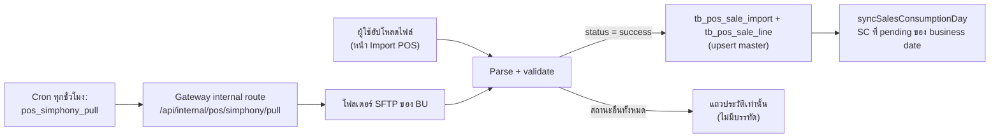

# นำเข้ายอดขาย POS (Import POS — Simphony / Micros 3700)

> **At a Glance**
> **วัตถุประสงค์:** นำยอดขาย POS รายวันเข้าระบบเป็นบรรทัดยอดขายดิบ ซึ่ง [Sales Consumption](/th/inventory/recipe/sales-consumption) จะแปลงเป็นการตัดสต๊อกต่อไป &nbsp;·&nbsp; **หน้าจอ:** `/operation-plan/import-pos` (เมนู: Operation Plan → Import POS) &nbsp;·&nbsp; **การตั้งค่า:** `/system-admin/interface/pos/simphony` และ `/system-admin/interface/pos/micros3700` &nbsp;·&nbsp; **API:** `api/:bu_code/pos-sales/imports*` &nbsp;·&nbsp; **ตาราง:** `tb_pos_store`, `tb_pos_outlet`, `tb_pos_department`, `tb_pos_item`, `tb_pos_sale_import`, `tb_pos_sale_line`, `tb_pos_sftp_pull_run` &nbsp;·&nbsp; **กลุ่มผู้ใช้:** นักพัฒนาและ QA; sysadmin สำหรับการตั้งค่าการเชื่อมต่อ

> **หมายเหตุขอบเขต** หน้านี้บันทึกพฤติกรรมที่เกี่ยวข้องกับสต๊อก: การนำเข้าเขียนอะไร เมื่อไรถูกปฏิเสธ และป้อนเข้าการตัดสต๊อกอย่างไร การตั้งค่าการเชื่อมต่อล้วน ๆ (ฟิลด์ SFTP host, licence) สรุปไว้เฉพาะใน §6
>
> **สถานะการ implement (ตรวจสอบแล้ว 2026-10-27)** Implement แล้ว: อัปโหลด Simphony Standard Export, ตรวจรายงาน Micros 3700 + นำเข้าพร้อม overwrite ต่อ outlet, ดึง Simphony SFTP ตามเวลา, ประวัติการนำเข้า, ยกเลิก ไม่มี Stock Out อัตโนมัติ ณ เวลานำเข้า — flow "preview / confirm" ต่อ outlet เดิมถูกเอาออกแล้ว (`ea3fc5c95`); การตัดสต๊อกเกิดขึ้นเฉพาะเมื่อ post Sales Consumption

## 1. ภาพรวม

ทุกความพยายามถูกบันทึก รวมถึงที่ล้มเหลว ประวัติจึงแสดงสิ่งที่เคยลอง มีเพียงไฟล์ว่างหรือไฟล์ binary เท่านั้นที่ตอบ HTTP 400 และไม่ถูกบันทึก

## 2. Brand และรูปแบบไฟล์

| Brand | อินพุต | ขนาดของการนำเข้าหนึ่งครั้ง | คีย์ซ้ำ (แถว success ที่ live) |
|---|---|---|---|
| `simphony` | ไฟล์ข้อความ Simphony Standard Export: header `GLID` หนึ่งบรรทัด + บรรทัด `MID`, business date เดียว, ≤ 10 MB | หนึ่งการนำเข้าต่อ store ต่อ business date | Partial unique index `pos_sale_import_live_success_u` บน `(store_id, doc_date)` เมื่อ `status = 'success'`, ไม่ถูกยกเลิก, brand `simphony` |
| `micros3700` | รายงาน Micros 3700: browser ดึงบรรทัดข้อความจาก PDF (`micros3700-pdf.ts`) และส่งบรรทัดไม่ใช่ตัวไฟล์; ตรวจแล้วจึงนำเข้า | หนึ่งการนำเข้าต่อ **outlet** ต่อ business date; แถวจาก PDF เดียวกันใช้ `batch_id` ร่วมกัน (รวมแถวที่ถูกปฏิเสธ) | `pos_sale_import_live_outlet_u` บน `(outlet_id, doc_date)` สำหรับ brand `micros3700` |

คีย์ซ้ำคือ store + business date **ไม่ใช่**สตริง `source` เพราะ `source` ฝังเวอร์ชันของ POS (`GLID#11`); มิฉะนั้นการ export ซ้ำหลังอัปเกรด POS จะหลุดผ่านไปได้ (comment ใน `schema.prisma`)

### 2.1 กฎการ parse ของ Simphony (`simphony.parser.ts`)

- ต้องมี header `GLID`; หมายเลข store (#2) ต้องไม่ว่าง; business date ต้องเป็น `YYYYMMDD` และเป็นวันที่จริง; วันที่แรกและวันที่สุดท้ายต้องเป็นวันเดียวกัน
- แต่ละบรรทัด `MID` ต้องมีอย่างน้อย 40 ฟิลด์; รหัส outlet (#2) และรหัส item (#4) ต้องไม่ว่าง; รหัส outlet, item และ department ต้อง ≤ 20 ตัวอักษร (คอลัมน์เป็น `VarChar(20)`)
- ไฟล์ที่เวอร์ชันต่ำกว่า 1.17 นำเข้าสำเร็จพร้อมคำเตือน `legacy_export_version`
- ไฟล์ที่ไม่มีบรรทัด `MID` เป็น `format_error`

### 2.2 สถานะการนำเข้า (`enum_pos_sale_import_status`)

| สถานะ | ความหมาย |
|---|---|
| `success` | เขียนบรรทัดแล้ว; upsert master (store, outlet, department, item) แล้ว |
| `rejected_duplicate` | มีการนำเข้า success ที่ live อยู่แล้วสำหรับ store (Simphony) / outlet (Micros) และ business date เดียวกัน แสดงสีเหลือง — ไม่ใช่ error |
| `missing_glid_header` | Simphony: ไม่มี header `GLID` |
| `multi_day_glid_reject` | Simphony: header `GLID` ครอบคลุมหลาย business date |
| `rejected_multi_day` | Micros 3700: ช่วงเวลารายงานครอบคลุมหลาย business date |
| `format_error` | ปัญหา parse/format อื่น ๆ (ข้อความใน `error_message`) |

`ingest_method` เป็น `manual` หรือ `sftp` ประวัติแสดง `line_count` และ `confirmed_line_count` (บรรทัดที่ตัดสต๊อกแล้ว); UI derive สถานะการยืนยัน: replaced, cancelled, not applicable, pending (ตัดแล้ว 0), partial, confirmed (`pos-import-status.ts`)

## 3. อัปโหลดด้วยมือ

| ขั้นตอน | Endpoint | พฤติกรรม |
|---|---|---|
| อัปโหลด Simphony | `POST pos-sales/imports/simphony` (multipart `file`) | ต้องมี licence `interface.pos.simphony`; คืน 201 พร้อมสรุปแม้เป็นการปฏิเสธ |
| ตรวจ Micros | `POST pos-sales/imports/micros3700/check` (body: ชื่อไฟล์, เวลาที่ดึง, บรรทัดข้อความ) | ต้องมี `interface.pos.micros3700` คืน `ready` (ต่อ outlet: สิ่งที่จะนำเข้าและสิ่งที่จะแทนที่) หรือ `rejected` ไม่ใช่การเรียกที่ไม่เขียนข้อมูล: จะ upsert แถว store และบันทึกไฟล์ที่ถูกปฏิเสธลงประวัติ; ไม่เคยเขียน outlet, item หรือบรรทัด |
| นำเข้า Micros | `POST pos-sales/imports/micros3700` | ตรวจใหม่ตั้งแต่ต้นและนำเข้าทีละ outlet outlet ที่มีการนำเข้า live อยู่แล้วต้องระบุชื่อใน `overwrite` (พร้อม `import_id` และ `stock_out_ids` ที่การตรวจแสดง) หรือใน `skip_outlet_codes`; มิฉะนั้น response เป็น `needs_resolution` และไม่เขียนอะไร outlet ที่ล้มเหลวหนึ่งตัวไม่ทำให้ผลของตัวอื่นหาย; มีการบังคับ time budget ของ request (`POS_SALE_IMPORT_TIME_BUDGET`) |
| Overwrite | ภายในการนำเข้า | การนำเข้าเดิมถูกยกเลิกและมี `replaced_by_id`; หากบรรทัดของมันอยู่บน Sales Consumption ที่ **post แล้ว** outlet จะล้มเหลวด้วย `POS_SALE_OUTLET_IN_POSTED_SC` — ต้อง void SC ก่อน การยินยอมที่ไม่ตรงกับที่ผู้ใช้เห็นล้มเหลวด้วย `POS_SALE_OVERWRITE_CONFLICT` |
| ยกเลิก | `POST pos-sales/imports/:import_id/cancel` | เฉพาะการนำเข้า `success` ที่ยังไม่ถูกยกเลิก ไม่มีบรรทัดที่ตัดสต๊อกแล้ว และไม่อยู่บน SC ที่ post แล้ว; มิฉะนั้น `POS_SALE_IMPORT_NOT_CONFIRMABLE`, `POS_SALE_IMPORT_CANCELLED` หรือ `POS_SALE_IMPORT_HAS_CONFIRMED_LINES` จะ re-sync SC ของวัน |
| ประวัติ / รายละเอียด | `GET pos-sales/imports`, `imports/:import_id`; `GET stores`, `outlets`, `items` | ตัวกรองรวม `brand`, `batch_id`; ตัวกรอง item `unmapped` / `mapped` / `ignored` |

บนหน้าจอ ปุ่มอัปโหลดแสดงเฉพาะ brand ที่เปิดใช้งานและ licence ไม่หมดอายุ เมื่อสัญญาของ BU เขียนได้ (`canWrite`) ตารางประวัติลิงก์ไปยังบรรทัดของการนำเข้าที่เลือก และต่อบรรทัดไปยัง Stock Out ของมัน (`/inventory-management/inventory-adjustment/:id?type=stock-out`)

## 4. การดึง Simphony SFTP ตามเวลา

- Trigger: `micro-cronjobs` job type `pos_simphony_pull` (`bu_codes`, `user_id`) แนะนำให้รันทุกชั่วโมง (`0 * * * *`, `max_retries: 0`); เรียก internal route ของ gateway `POST /api/internal/pos/simphony/pull` พร้อม `x-internal-token` (`InternalJobGuard` ไม่ใช่ Keycloak) `user_id` เป็นผู้กระทำของการนำเข้าที่สร้างและเป็นผู้รับการแจ้งเตือนความล้มเหลว จึงต้องเป็นสมาชิกของทุก BU ที่ระบุ
- Backend ตัดสินว่าถึงเวลาดึงหรือไม่: เทียบ **ชั่วโมง** ของเวลาท้องถิ่นของ BU กับชั่วโมงของ `schedule_time` (ไม่สนนาที) และข้ามเมื่อมี run ที่ `completed` ของ business day นั้นอยู่แล้ว (`isPullDue`) Timezone ใช้ของ BU; timezone ที่ไม่รู้จักถอยไปใช้ค่า default
- ข้อจำกัดคงที่ (`SFTP_PULL_SETTINGS`): connect timeout 30 วินาที, retry 3 ครั้งห่างกัน 60 วินาที (สูงสุด 4 ครั้ง), ย้อนหลัง 7 วัน, ไฟล์ต้องเก่ากว่า 5 นาที, สูงสุด 50 ไฟล์และ 10 MB ต่อไฟล์ต่อ run, run budget 25 นาที, run ที่ `running` เกิน 30 นาทีถือว่าถูกทิ้ง มีแถว `running` ได้เพียงหนึ่งแถวต่อ brand (partial unique index `pos_sftp_pull_run_running_u`)
- ไฟล์ในโฟลเดอร์ระยะไกลถูกกรองด้วย glob ที่ตั้งค่า (`*`, `?`, ไม่สนตัวพิมพ์เล็กใหญ่, ไม่มี `/`) จากนั้นนำเข้าเหมือนอัปโหลดด้วยมือ (`ingest_method = sftp`) ผลของ run: `tb_pos_sftp_pull_run.status` ∈ `running` / `completed` / `connect_failed` / `host_key_mismatch` / `failed` / `abandoned` พร้อมผลต่อไฟล์ `imported` / `rejected` / `failed` / `too_large` / `not_attempted` Host key ถูก pin จาก run ที่ผ่านการ authenticate เท่านั้น; ค่าที่ไม่ตรงถูกเก็บให้ admin เปรียบเทียบแต่ไม่เคยใช้เป็น pin
- การแจ้งเตือนความล้มเหลวส่งวันละครั้ง (`is_alert_sent`) `GET pos-sales/sftp-pulls/latest` ป้อน panel "last pull" บนหน้า Import POS

## 5. สิ่งที่การนำเข้าเขียน

1. Upsert store (`brand` + `store_key`), outlet, department และ item ที่พบในไฟล์ (`pos-sale-master-upsert.ts`) Outlet ใหม่เริ่ม **ไม่มี Location**; item ใหม่เริ่ม **ไม่มี recipe** และ `is_ignored = false` — ต้อง map ใน Sales Consumption ก่อน post
2. เขียน `tb_pos_sale_import` (`doc_date`, `total_records`, `total_sales_amount`, `warnings`) และหนึ่ง `tb_pos_sale_line` ต่อ (import, outlet, item) — unique `pos_sale_line_import_outlet_item_u`
3. เรียก `syncSalesConsumptionDay` สำหรับ business date ใน transaction เดียวกัน (ดู [Sales Consumption §8](/th/inventory/recipe/sales-consumption))

ณ จุดนี้ไม่มีสต๊อกเคลื่อนไหว

## 6. การตั้งค่า POS Interface (สรุป)

Config ต่อ BU เก็บเป็นแถว `tb_application_config` ชื่อ `interface_pos_simphony` และ `interface_pos_micros3700` (หน้า `/system-admin/interface`; ฟอร์ม POS รวมเดิมถูกแยกแล้ว `f447132b`)

| Brand | ฟิลด์ | หมายเหตุ |
|---|---|---|
| Simphony | `enabled`, `sftp_host` (hostname/IPv4/IPv6), `sftp_port` (1–65535, default 22), `sftp_username`, `sftp_password`, `remote_folder_path` (default `/export/`, ห้ามมี `..`), `file_pattern` (default `GLExport_*.txt`, ≤ 100 ตัวอักษร, ห้ามมี `/`), `schedule_time` (`HH:mm`, default `03:00`) | รหัสผ่านเก็บแบบเข้ารหัสและคืนแบบ mask เป็น `***ENCRYPTED***`; การ save ซ้ำด้วย mask จะคงความลับที่เก็บไว้ การดึงปฏิเสธ host แบบ loopback / link-local (`resolve-allowed-host.ts`) |
| Micros 3700 | `enabled` เท่านั้น | Brand แบบอัปโหลดอย่างเดียว; ไม่มีการเชื่อมต่อ |

`enabled === true` อย่างน้อยหนึ่ง brand คือสิ่งที่ทำให้ Import POS และ Sales Consumption ปรากฏ (`readEnabledPosBrands`, `GET pos-sales/status`) การเปิดใช้ต้องมี licence ของ brand; licence ที่หมดอายุทำให้หน้าจออ่านได้แต่เป็น read-only

## 7. กรณีพิเศษ

| # | กรณี | พฤติกรรม |
|---|---|---|
| 1 | อัปโหลด Simphony store/วันที่เดียวกันสองครั้ง | ครั้งที่สองถูกบันทึกเป็น `rejected_duplicate`; กันการอัปโหลดขนานด้วย partial unique index ด้วย (ผู้แพ้ถูกอ่านใหม่และบันทึกเป็น duplicate) |
| 2 | อัปโหลดการนำเข้าที่ถูกยกเลิกซ้ำ | อนุญาต — unique index ครอบคลุมเฉพาะ success ที่ live (ไม่ถูกยกเลิก) |
| 3 | ไฟล์ของวันที่อยู่ในงวดที่ปิดแล้ว | นำเข้าได้ตามปกติ; period gate ใช้ภายหลังตอน post SC |
| 4 | รหัส item ยาวกว่า 20 ตัวอักษร | ปฏิเสธทั้งไฟล์เป็น `format_error` |
| 5 | ไฟล์มาช้าหลัง SC ของวันถูก post แล้ว | บรรทัดยังไม่ถูกผูก ("late lines") จนกว่า SC จะถูก void |
| 6 | BU ที่ปิด / ไม่ตั้งค่า SFTP | ข้ามการดึงโดยไม่ error; timezone ที่เก็บไว้ไม่ถูกต้องไม่ทำให้เกิด exception |
| 7 | Cron สองอินสแตนซ์ / trigger ด้วยมือซ้อนกัน | มีแถว `running` เดียวต่อ brand (partial unique index); run ที่สองเริ่มไม่ได้ขณะมี run ทำงานอยู่ |

## 8. แหล่งอ้างอิง

`apps/micro-business/src/inventory/pos-sale/{pos-sale-import.service.ts,pos-sale-micros3700.service.ts,pos-sale-sftp-pull.service.ts,parsers/*,sftp/*,import-writer/*}`, gateway `application/pos-sales/{pos-sales.controller.ts,pos-sales-internal.controller.ts}`, schema `tb_pos_*`, `micro-cronjobs` `internal/executor/pos_simphony_pull.go` และ README, frontend `routes/operation-plan/import-pos/*` และ `routes/system-admin/interface/pos/*` ที่เกี่ยวข้อง: [Sales Consumption](/th/inventory/recipe/sales-consumption), [Application Config](/th/inventory/system-config/application-config)
