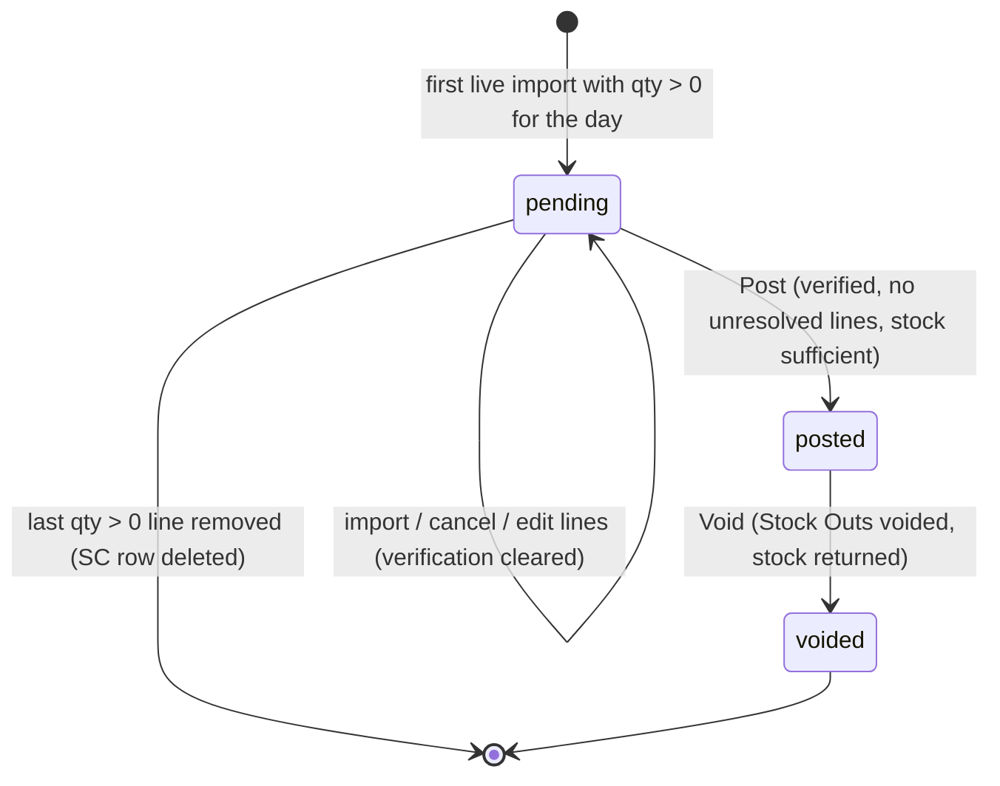

# Sales Consumption (ยอดขาย POS → Stock Out)

> **At a Glance**
> **วัตถุประสงค์:** แปลงยอดขาย POS ที่นำเข้าเป็นการตัดสต๊อก — หนึ่งเอกสารต่อวันขาย, explode สูตรเป็นวัตถุดิบ, post เป็น Stock Out ประเภท `SALE` ที่ completed หนึ่งใบต่อ location &nbsp;·&nbsp; **หน้าจอ:** `/operation-plan/sales-consumption` (ปฏิทิน / ตาราง / mapping) และ `/operation-plan/sales-consumption/:id` &nbsp;·&nbsp; **ตาราง:** `tb_sales_consumption`, `tb_pos_sale_line`, `tb_pos_item`, `tb_pos_outlet`, `tb_stock_out.sales_consumption_id` &nbsp;·&nbsp; **API:** `api/:bu_code/pos-sales/sales-consumptions*` &nbsp;·&nbsp; **ค่าสถานะ:** `pending` / `posted` / `voided` &nbsp;·&nbsp; **กลุ่มผู้ใช้:** นักพัฒนาและ QA (เส้นทางการตัดสต๊อก); Cost Controller และ Outlet Manager ในฐานะผู้ใช้

> **สถานะการ implement (ตรวจสอบกับซอร์ส 2026-10-27)** Implement ครบตั้งแต่ต้นจนจบ: ฟีเจอร์เข้า backend เป็น PR #945 (`feature/sales-consumption`, merge แล้ว) และเข้า frontend ระหว่าง `f75b4b2a` ถึง `27eaf276` นี่คือจุดแรกที่สูตรขับเคลื่อน inventory movement จริง **ไม่ใช่**รายงานความแปรปรวน food-cost: ไม่มีอะไรเปรียบเทียบการตัดสต๊อกเหล่านี้กับการนับจริง และดีไซน์ "theoretical consumption" เดิม (ดู [Recipe](/th/inventory/recipe) §3) ถูกทำให้เป็นจริงที่นี่เพียงในรูปการ post รายวันที่คนตรวจสอบ ไม่ใช่ OUT อัตโนมัติต่อการขาย

## 1. ภาพรวม

ระบบ POS รายงานสิ่งที่ *ขาย* (menu item); คลังสินค้าต้องรู้สิ่งที่ *ถูกใช้* (สินค้า) Sales Consumption (SC) เชื่อมสองฝั่งเข้าด้วยกัน:

```
POS file (Simphony / Micros 3700)  →  Import (บรรทัดขายดิบ ต่อ store/outlet/item)
   →  Sales Consumption ของวันขายนั้น (pending)
   →  map แต่ละบรรทัดไปยัง Location + Recipe (หรือ Ignore)
   →  explode สูตร (sub-recipe, wastage, การแปลงหน่วย) เป็นปริมาณสินค้า
   →  Verify ยอดคงเหลือต่อ location (ณ วันขาย)
   →  Post  →  Stock Out ที่ completed หนึ่งใบ (adjustment type SALE) ต่อ location ลงวันที่วันขาย
```

หลักพื้นฐาน:

- **หนึ่ง SC ที่ live ต่อวันขาย** Partial unique index `sales_consumption_live_day_u` บน `(sale_date)` เมื่อ `status <> 'voided'` อนุญาตเพียงหนึ่ง SC ที่ไม่ voided ต่อวัน (migration SQL ไม่สามารถแสดงใน Prisma ได้) SC ที่ voided คงอยู่เป็นประวัติ
- **เลข SC** คือ `SC-YYYYMMDD-NN` โดย `NN` = (จำนวน SC ของวันนั้นทุกสถานะ) + 1 (`nextScNo`) ดังนั้น void จึงให้ `-02` สำหรับตัวแทน
- **ฝั่ง import** อยู่ใน [Import POS](/th/inventory/recipe/import-pos) หน้านี้เริ่มเมื่อมีบรรทัดขายที่ live
- โมดูลนี้มองเห็นได้เมื่อ BU เปิด POS interface เท่านั้น (§9)

## 2. เอนทิตีและสถานะ

| เอนทิตี | บทบาท | ฟิลด์สำคัญ (แหล่ง: `schema.prisma`) |
|---|---|---|
| `tb_pos_sale_import` | ไฟล์ POS หนึ่งไฟล์ที่อัปโหลด/ดึงมา | `brand` (`simphony`/`micros3700`), `doc_date` (business date), `status`, `cancelled_at` |
| `tb_pos_sale_line` | item หนึ่งที่ขายที่ outlet หนึ่งในการนำเข้าหนึ่งครั้ง | `import_id`, `outlet_id`, `item_id`, `qty`, `unit_price`, `total`; override `location_id`, `recipe_id`, `is_ignored` (nullable = "ตาม master"); `sales_consumption_id`, `stock_out_id` |
| `tb_pos_outlet` | master ของ POS outlet | `store_id`, `code` (≤ 20), `name`, `location_id` (การ map outlet → Location) |
| `tb_pos_item` | master ของ POS menu item | `store_id`, `code` (≤ 20), `desc1`, `recipe_id` (การ map item → Recipe), `is_ignored` (default false) |
| `tb_sales_consumption` | เอกสารรายวัน | `sc_no`, `sale_date`, `status`, `onhand_verified_at`, `onhand_verified_ok`, `onhand_verified_signature`, `posted_*`, `voided_*`, `void_reason`, `doc_version` |
| `tb_stock_out` | ผลของการ post | FK `sales_consumption_id` (Restrict); หนึ่งแถวต่อ location; `info = { sales_consumption_id }` |

`enum_sales_consumption_status`: `pending` → `posted` → `voided` ไม่มีขั้น draft/approval



การ void เปิดวันนั้นใหม่เป็น SC ที่ pending **ใบใหม่** (เมื่อมีบรรทัดเหลือให้ตัด); เอกสารที่ voided ไม่ถูกใช้ซ้ำ

## 3. บรรทัดขายถูก resolve อย่างไร

แต่ละบรรทัดขายถูก resolve เป็น **location**, **recipe** และ flag **ignore** ที่มีผลโดย `resolveLine` (`sales-consumption/resolve-line.ts`) ค่าบน *บรรทัด* ชนะ *master*

| ด้าน | กฎ |
|---|---|
| Location | `line.location_id` หากตั้งไว้ มิฉะนั้น `outlet.location_id` location ที่ถูก soft-delete นับเป็น **ไม่มี location** |
| Recipe / ignore | `line.is_ignored = true` → ignore ไม่มี recipe มิฉะนั้น `line.recipe_id` → recipe นั้น มิฉะนั้น `line.is_ignored = false` โดยไม่มี recipe → ระบุชัดว่า "ไม่มี recipe" นอกนั้นใช้ master `tb_pos_item` (`recipe_id`, `is_ignored`) DB CHECK ห้าม `is_ignored = true` ร่วมกับ `recipe_id` |
| สถานะ (ตัวแรกที่ตรงชนะ) | `qty ≤ 0` หรือ ignore → `not_counted` · ไม่มี location → `needs_location` · ไม่มี recipe → `needs_recipe` · นอกนั้น `ok` |

`needs_location` และ `needs_recipe` คือสถานะ **unresolved** ซึ่งบล็อกทั้ง Verify และ Post บรรทัดที่ตัดสต๊อกแล้ว (`stock_out_id` ถูกตั้ง) จะไม่ถูก explode ซ้ำ

### 3.1 การแก้ไขบรรทัด (`PATCH .../sales-consumptions/:id/lines`)

Body: `line_ids[]` และ `location_id`, `recipe_id`, `is_ignored` ตัวใดก็ได้ บวก `set_item_default` กฎใน `updateLines`:

- SC ต้องเป็น `pending`; ทุก id ต้องเป็นของ SC นี้และยังไม่ถูกตัดสต๊อก มิฉะนั้น `SALES_CONSUMPTION_LINE_POSTED`
- ต้องมีอย่างน้อยหนึ่งในสามฟิลด์; `recipe_id` ร่วมกับ `is_ignored = true` ถูกปฏิเสธ (`COMMON_VALIDATION_FAILED`) `location_id` / `recipe_id` ที่ไม่มีอยู่ (soft-delete นับเป็นไม่มี) ถูกปฏิเสธ
- เมื่อ `set_item_default = true` ค่า recipe/ignore จะถูกเขียนลง **master ของ item** และบรรทัดกลับไป "ตาม master" (`recipe_id = null`, `is_ignored = null`); มิฉะนั้นเป็น override ต่อบรรทัด Location เป็น override ต่อบรรทัดเสมอ
- การแก้ไขใด ๆ ล้างการตรวจยอดคงเหลือที่เก็บไว้และเพิ่ม `doc_version` ของ SC

## 4. Recipe Explosion

`explodeSaleLines` (`pos-sale/explosion/explode-sale-lines.ts`) แปลงบรรทัด `ok` เป็นปริมาณ **สินค้า → หน่วย inventory** โดยจงใจให้สอดคล้องกับเครื่องคำนวณต้นทุนสูตร เพื่อให้ปริมาณที่ตัดตรงกับต้นทุนสูตร

1. สำหรับสูตรที่ขาย: `batches = sold_qty ÷ recipe.base_yield`
2. บรรทัดสินค้า: inventory qty = `inventory_qty` ที่ save ไว้เมื่อ save กับหน่วย inventory ปัจจุบันของสินค้า มิฉะนั้น `qty × from_qty ÷ to_qty` (อัตราส่วนไม่ปัดเศษ) คูณด้วย `(1 + wastage% / 100)`
3. บรรทัด sub-recipe: `qty` ต้องเป็นหน่วย `base_yield_unit` ของ sub-recipe (1:1); batch ของ sub-recipe ต่อ batch ของสูตรแม่ = `qty × (1 + wastage%/100) ÷ sub.base_yield` ใช้กับความต้องการต่อ batch ของ sub-recipe เอง แบบ recursive (สูงสุด **10** ระดับ, `MAX_RECIPE_DEPTH`; สูตรที่ขายคือระดับ 1)
4. ยอดรวมปัด half-up เป็น 5 ตำแหน่งตอนท้าย

บรรทัดขายที่ explode ไม่ได้ **จะไม่ถูกตัดครึ่งเดียว**: ไม่เพิ่มอะไรและถูกรายงานเป็นปัญหาด้วยหนึ่งในเหตุผลเหล่านี้:

| เหตุผล | ความหมาย |
|---|---|
| `no_conversion` | สินค้าหาย/ถูก soft-delete, หน่วยแปลงไม่ได้ (ด้านใดด้านหนึ่งของอัตราส่วน ≤ 0) หรือบรรทัด sub-recipe ใช้หน่วยอื่นที่ไม่ใช่หน่วย yield ของ sub-recipe |
| `zero_yield` | สูตรหนึ่งในสายมี `base_yield ≤ 0` |
| `too_deep` | ซ้อนเกิน 10 ระดับ (loop ของ sub-recipe จบที่นี่ด้วย) |
| `recipe_unusable` | สูตรหาย, `is_active = false` หรือถูก soft-delete |
| `empty_recipe` | การไล่ไม่ได้ปริมาณที่เป็นบวก (ไม่มีบรรทัดวัตถุดิบที่ live หรือมีแต่บรรทัด qty 0) |

"ปัญหาวัตถุดิบ" เหล่านี้แสดงบนหน้ารายละเอียดและนับเป็น unresolved: บล็อก Verify และ Post เหมือนบรรทัด `needs_*`

> flag `deduct_from_stock` ของสูตร ([Data Model](/th/inventory/recipe/01-data-model)) **ไม่ถูกอ่าน**โดย explosion สูตรที่ `deduct_from_stock = false` ยังถูกตัดเมื่อบรรทัด POS map มาที่มัน ดู §10

## 5. Verify ยอดคงเหลือ (`POST .../sales-consumptions/:id/verify-onhand`)

- ต้องเป็น `pending` และไม่มีบรรทัด/ปัญหาที่ unresolved
- สำหรับแต่ละ location และวัตถุดิบ เปรียบเทียบปริมาณที่ต้องการกับ `getDrawableQtyAsOf(product, location, sale_date, costing method)` `short = required − available` เมื่อเกิน `1e-9`
- เก็บ `onhand_verified_at`, `onhand_verified_ok` (true เมื่อไม่มีอะไรขาดเท่านั้น) และ `onhand_verified_signature` — SHA-256 ของบรรทัดที่มีผลที่เรียงแล้ว (id, location, recipe, ignore flag, qty) การเปลี่ยนบรรทัดใด ๆ ภายหลัง การ map master ที่เปลี่ยนการ resolve หรือการนำเข้าใหม่/ที่ถูกยกเลิก จะเปลี่ยน signature (หรือล้างฟิลด์) และทำให้การตรวจสอบ **stale**
- ผลต่อสินค้าของ verify ครั้งล่าสุดถูกเก็บในหน้า browser เท่านั้น; หลัง refresh endpoint รายละเอียดคืนเพียงเวลา / ok / stale และปุ่ม **Post** ตัดสินจากการตรวจสอบที่เก็บไว้นั้น

## 6. Post (`POST .../sales-consumptions/:id/post`, body `doc_version`)

หนึ่งฐานข้อมูล transaction (timeout 25 วินาที) ความล้มเหลวใด ๆ จะไม่ post อะไรเลย ลำดับการตรวจใน `post()`:

1. SC lock: day-level advisory lock แล้วจึงแถว SC; สถานะต้องเป็น `pending` (`SALES_CONSUMPTION_NOT_PENDING`); `doc_version` ต้องตรง (optimistic lock) ไม่มี `doc_version` คือ `COMMON_DOC_VERSION_REQUIRED`
2. **Period gate:** วันขายต้องอยู่ในงวด inventory ที่เปิดอยู่ปัจจุบัน (`STOCK_OUT_DATE_NOT_CURRENT_PERIOD` / `STOCK_OUT_NO_OPEN_PERIOD`)
3. บรรทัด unresolved หรือปัญหาวัตถุดิบ → `SALES_CONSUMPTION_HAS_UNRESOLVED_LINES` (พร้อม `count`)
4. ต้องมีการตรวจสอบ ตรงกับ signature ปัจจุบัน และเป็น `ok`: `SALES_CONSUMPTION_NOT_VERIFIED` / `_VERIFY_STALE` / `_VERIFY_FAILED`
5. ต้องมี adjustment type ที่มี code **`SALE`** (type stock-out, ไม่ถูกลบ, active) มิฉะนั้น `POS_SALE_ADJUSTMENT_TYPE_MISSING` สร้างโดย tenant seed set `pos-sale-adjustment-type.seed-set.ts` (`cc2ab4eba`)
6. สต๊อกถูก **ตรวจซ้ำภายใน transaction** (อาจเปลี่ยนตั้งแต่ Verify); ความขาดของทุก location ถูกรายงานรวมกันเป็น error สต๊อกไม่พอ
7. เลข Stock Out ถูกจอง (series `STOCK-OUT` ลงวันที่วันขาย) จากนั้นต่อ location (เรียงตาม location code) เขียน Stock Out ที่ **completed**: draft header → หนึ่งแถว detail และหนึ่ง ledger movement ต่อวัตถุดิบ (`executeAdjustmentOut`, ตีมูลค่าด้วยวิธีคิดต้นทุนของ BU) → `completed` คำอธิบาย: `Sales Consumption <sc_no> · <loc code> <loc name>` หนึ่งบรรทัด detail ต่อสินค้าวัตถุดิบที่ยอดรวมเป็นบวก พร้อม snapshot ของ code/ชื่อ/ชื่อท้องถิ่น/sku ของสินค้า
8. บรรทัดขายถูกจอง (`stock_out_id` ถูกตั้ง) ด้วย conditional update; หากมีบรรทัดถูกแย่งพร้อมกัน การ post ทั้งหมดจะ rollback (`POS_SALE_CONFIRM_CONFLICT`)
9. SC เป็น `posted` พร้อม `posted_at`, `posted_by_id`, `doc_version + 1`

บรรทัดสถานะ `not_counted` (qty ≤ 0 หรือ ignore) ไม่ได้ Stock Out แต่ยังผูกกับ SC ที่ posted

## 7. Void (`POST .../sales-consumptions/:id/void`, body `void_reason?`, `doc_version`)

Permission `inventory_management.stock_out.delete` (ไม่ผูกกับการเปิด POS ใน UI — BU ที่ปิด POS ยัง void ได้)

1. SC ต้องเป็น `posted`; `doc_version` ต้องตรง
2. งวดของวันขายต้องยังเปิดอยู่ มิฉะนั้น `SALES_CONSUMPTION_VOID_PERIOD_CLOSED`
3. ทุก Stock Out ของ SC ที่ไม่ voided ถูก void ใน transaction เดียวกัน (`voidStockOutInTx` พร้อม `viaSalesConsumption: true`) — สต๊อกถูกคืน การ void Stock Out ดังกล่าว *โดยตรง* จากหน้า Inventory Adjustment ถูกปฏิเสธด้วย `STOCK_OUT_VOID_VIA_SALES_CONSUMPTION` ("void it from the Sales Consumption instead")
4. SC → `voided` (`voided_at`, `voided_by_id`, `void_reason`); บรรทัดของมันถูกปล่อย และ `syncSalesConsumptionDay` สร้าง **SC pending ใบใหม่** ของวันนั้นที่รับบรรทัดเหล่านั้นบวกบรรทัดที่มาช้า (§8) `new_sc_id` เป็น `null` เมื่อไม่มีอะไรเหลือให้ตัด UI นำทางไปยัง SC ใหม่

## 8. Daily Sync และบรรทัดที่มาช้า

`syncSalesConsumptionDay` (เรียกภายในทุก transaction ของ import, cancel และ overwrite ภายใต้ day advisory lock):

- บรรทัดที่เข้าเกณฑ์: `stock_out_id IS NULL`, import `status = success`, ไม่ถูกยกเลิก, `doc_date = วันขาย`
- ไม่มี SC ที่ live และมีบรรทัดที่เข้าเกณฑ์อย่างน้อยหนึ่งที่ `qty > 0` → สร้าง SC pending มิฉะนั้นผูกทุกบรรทัดที่เข้าเกณฑ์ (qty ใดก็ได้) และถอดบรรทัดที่ import ถูกยกเลิก
- หากไม่เหลือบรรทัดที่ `qty > 0` บรรทัดจะถูกปล่อยและแถว SC ที่ pending ถูก **ลบ**
- หากชุดบรรทัดเปลี่ยน ฟิลด์การตรวจยอดคงเหลือถูกล้าง
- หาก SC ของวันนั้น `posted` แล้ว ฟังก์ชันคืนค่าโดยไม่ผูก: บรรทัดจาก import ที่มาภายหลังคือ **บรรทัดที่มาช้า** (`late_lines` บนรายละเอียดและปฏิทิน) พวกมันค้างโดยไม่ผูกจนกว่า SC ที่ posted จะถูก void (§7) — ไม่มี action "เพิ่มเข้า SC ที่ posted"

Import ไม่สามารถยกเลิกได้เมื่อบรรทัดใดของมันถูกตัดสต๊อกแล้วหรืออยู่บน SC ที่ posted (`POS_SALE_IMPORT_HAS_CONFIRMED_LINES`; `LOCKED_SALE_LINE` ใน `pos-sale.constants.ts`)

## 9. หน้าจอ, Permission และการมองเห็น

| หน้าจอ / action | แหล่ง | Gate |
|---|---|---|
| เมนู **Import POS** และ **Sales Consumption** ใต้ Operation Plan | `constant/module-list.ts` | ซ่อนเว้นแต่ BU เปิด POS brand ≥ 1 (`requiresPosInterface`, `useVisibleModules`; เข้า URL ตรงแสดงหน้า "POS not enabled" ผ่าน `RouteGuard`) licence feature `interface.pos` Sales Consumption ต้องมี `inventory_management.stock_out.view` เพิ่ม; Import POS ไม่ระบุ permission ในเมนู |
| `/operation-plan/sales-consumption` | `sc-list-page.tsx` | แท็บ: **calendar** (default), **list**, **mapping** (`?view=`), เดือนใน `?month=` แถบสรุปด้านบน; แถบเตือนเมื่อ POS outlet ใดไม่มี Location (ปุ่มเปิด mapping แสดงเฉพาะผู้มีสิทธิ์เขียน) |
| `/operation-plan/sales-consumption/:id` | `sc-detail-page.tsx` | แท็บ **Sales** (default; **Ingredients** สำหรับ SC ที่ voided), **Ingredients**, **History** Header แสดงเลข SC, สถานะ, วันขาย, จำนวน import, ยอดขาย, Stock Out ที่ผูก (ที่ voided ขีดฆ่าและลิงก์ไม่ได้) และสำหรับ SC ที่ voided แสดง SC ตัวแทน |
| API list / detail / calendar | gateway `pos-sales.controller.ts` | `inventory_management.stock_out.view` |
| แก้บรรทัด, Verify, Post, PATCH outlet/item (mapping) | เหมือนกัน | `inventory_management.stock_out.create` |
| Void | เหมือนกัน | `inventory_management.stock_out.delete` |
| Import / cancel / history / stores / outlets / items GET | เหมือนกัน | ไม่มี `@Permission`; licence `interface.pos` (`'app:pos-sales': 'interface.pos'` ใน `permission.route-map.ts`) และสำหรับอัปโหลด licence ต่อ brand `interface.pos.simphony` / `.micros3700` |

ใน UI ตัวควบคุมการแก้ไขต้องมี `usePosWritable()`: สัญญาของ BU เขียนได้ **และ** `stock_out.create` **และ** มี brand ที่เปิดใช้อย่างน้อยหนึ่งตัวที่ licence ไม่ `expired` Licence หมดอายุ = read-only

ทุก method ของ service SC ตรวจก่อนว่ามี POS brand เปิดใช้ในการตั้งค่า interface ของ BU (`readEnabledPosBrands`: `interface_pos_simphony` / `interface_pos_micros3700` ที่ `value.enabled === true`); มิฉะนั้น `SALES_CONSUMPTION_POS_NOT_ENABLED` `GET .../pos-sales/status` คืน brand ที่เปิดใช้

### 9.1 สถานะวันบนปฏิทิน (`buildCalendar`)

| `status` | เงื่อนไข (ตัวแรกที่ตรง) |
|---|---|
| `posted` | วันนั้นมี SC ที่ posted |
| `pending` | วันนั้นมี SC ที่ pending หรือมีบรรทัด live ที่ qty > 0 |
| `no_sales` | มี import ที่ live ของวันนั้นแต่ไม่มีบรรทัดที่ qty > 0 |
| `future` | วัน ≥ วันนี้ |
| `before_start` | ก่อน import live ครั้งแรกสุด |
| `no_file` | วันที่ผ่านมาแล้วในหรือหลัง import ครั้งแรก โดยไม่มี import ที่ live |

ตัวนับเพิ่มเติมต่อวัน: `unresolved_count`, `late_lines` (เฉพาะวันที่ posted) และ `missing_stores` — store ที่มี import live ใน 7 วันก่อนหน้าแต่ไม่มีในวันนี้ (เฉพาะวันระหว่างวัน import แรกถึงวันนี้)

### 9.2 แท็บ Mapping

สอง grid เหนือ master: **Outlets** (outlet → Location; `PATCH pos-sales/outlets/:outlet_id`, Location ต้องมีอยู่) และ **Items** (item → Recipe หรือ Ignore; `PATCH pos-sales/items/:item_id`, recipe ต้องมีอยู่และห้ามรวมกับ `is_ignored = true`; ตัวกรอง `unmapped` / `mapped` / `ignored`) การเปลี่ยน mapping ของ master จะ resolve ใหม่ทุกบรรทัด *pending* ที่ตาม master และทำให้การตรวจสอบก่อนหน้า stale บรรทัดที่ posted แล้วไม่ถูกแตะ

## 10. กรณีพิเศษ

| # | กรณี | พฤติกรรม |
|---|---|---|
| 1 | สองคน post SC เดียวกัน | Row lock + `doc_version`: คนที่สองได้ error stale-version / not-pending; ได้ชุด Stock Out เดียวเท่านั้น |
| 2 | สต๊อกเปลี่ยนระหว่าง Verify กับ Post | Post ตรวจซ้ำใน transaction; ความขาดทำให้ยกเลิกทั้งหมดและแสดงวัตถุดิบที่ขาดทุกตัว |
| 3 | แก้บรรทัดหลัง Verify | ล้างการตรวจสอบ; Post ล้มเหลวด้วย `SALES_CONSUMPTION_NOT_VERIFIED` จนกว่าจะ verify ใหม่ |
| 4 | Location ถูกลบหลัง map | บรรทัดกลายเป็น `needs_location` |
| 5 | Recipe ถูก deactivate / ลบหลัง map | ปัญหา explosion `recipe_unusable` บล็อกทั้งวัน (การ deactivate/archive สูตรที่สูตรอื่นใช้ถูกบล็อกที่ระดับ recipe แต่ไม่ตรวจ mapping ของ POS item) |
| 6 | สูตรเดียวกันขายหลาย outlet/location | Explode ต่อ location ที่มีผล; หนึ่ง Stock Out ต่อ location |
| 7 | วันขายอยู่ในงวดที่ปิดแล้ว | ปฏิเสธ Post (`STOCK_OUT_DATE_NOT_CURRENT_PERIOD`); ปฏิเสธ void (`SALES_CONSUMPTION_VOID_PERIOD_CLOSED`) |
| 8 | ไฟล์ถูกนำเข้าหลังวันนั้น post แล้ว | กลายเป็นบรรทัดที่มาช้า; ถูกติดธงบนปฏิทิน; ถูกรับเข้าหลัง void เท่านั้น |
| 9 | ยกเลิก import ที่บรรทัดอยู่บน SC ที่ pending | อนุญาต; บรรทัดถูกถอด, SC ถูก sync ใหม่หรือถูกลบ |
| 10 | Micros 3700 overwrite outlet ที่บรรทัดอยู่บน SC ที่ posted | Outlet ล้มเหลวด้วย `POS_SALE_OUTLET_IN_POSTED_SC`; ต้อง void SC ก่อน |
| 11 | ปิด POS integration ขณะมีเอกสารอยู่ | List/detail/post/verify คืน `SALES_CONSUMPTION_POS_NOT_ENABLED`; void ยังทำงาน |
| 12 | บรรทัด POS ที่ปริมาณเป็นศูนย์หรือ voided | `not_counted`; ไม่เคยถูกตัด |

## 11. ข้อค้นพบในโค้ดและข้อเสนอแนะ

| ข้อค้นพบ | หลักฐาน | ข้อเสนอแนะ |
|---|---|---|
| `deduct_from_stock` ไม่มีผลต่อการตัดสต๊อก POS | `explode-sale-lines.ts` / `load-recipe-graph.ts` ไม่เคย select คอลัมน์นี้ | ให้เคารพ flag ตอน resolve บรรทัด หรือเอา toggle ออกจากฟอร์มสูตร |
| guard ระดับ recipe ไม่สนใจ mapping ของ POS | `findRecipeUsers` สแกนเฉพาะ `tb_recipe_ingredient` | รวม `tb_pos_item.recipe_id` ในการตรวจ "in use" หรือแสดงใน error |
| ผล verify ต่อสินค้าบนหน้ารายละเอียดหายเมื่อ refresh | `sc-detail-page.tsx` เก็บไว้ใน component state | Persist ผลต่อสินค้าหรือดึงใหม่ตามต้องการ |
| Test coverage | `carmen-frontend-e2e` ที่ `d795a25` ไม่มี spec, test-case catalogue หรือ user story สำหรับ Import POS / Sales Consumption (ตรวจ tree listing หา `pos`/`sales`/`consum`) | ดู [Test Scenarios](/th/inventory/recipe/04-test-scenarios) สำหรับ matrix แบบ manual ที่ควร automate |

## 12. แหล่งอ้างอิง

- Backend: `apps/micro-business/src/inventory/sales-consumption/*` (service, sync, calendar, ingredients, history, `resolve-line.ts`, `line-signature.ts`, `pos-enabled.ts`), `apps/micro-business/src/inventory/pos-sale/{stock-out-poster.ts,explosion/*,pos-sale-mapping.service.ts}`, gateway `apps/backend-gateway/src/application/pos-sales/pos-sales.controller.ts`, error catalog `SALES_CONSUMPTION_*` / `POS_SALE_*`
- Schema: `packages/prisma-shared-schema-tenant/prisma/schema.prisma` (`tb_sales_consumption`, `tb_pos_*`, `tb_stock_out.sales_consumption_id`)
- Frontend: `carmen-frontend/routes/operation-plan/{sales-consumption,shared}/*`, `constant/module-list.ts`, `hooks/use-visible-modules.ts`, `components/route-guard.tsx`
- ที่เกี่ยวข้อง: [Import POS](/th/inventory/recipe/import-pos), [Recipe](/th/inventory/recipe), [Data Model](/th/inventory/recipe/01-data-model), [Business Rules](/th/inventory/recipe/02-business-rules)
